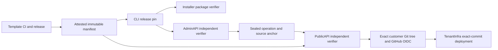
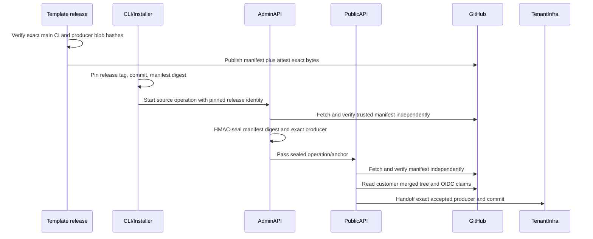

# Plan: Release-attested template producer manifests

- **Engineer:** Van / #3503 delivery team
- **Primary repo:** `eai-support/eai-app-template`
- **Issue:** `enterpriseaigroup/Issues2025#3503`
- **Status:** approved for isolated branch implementation; release activation and merge remain gated by the controls and evidence below

## 1. Why — business outcome

Every new approved app-template commit currently needs a separate AdminAPI and PublicAPI code change that adds its commit and workflow/collector hashes to static allowlists. Template release 1.0.17 required AdminAPI #475 and PublicAPI #1106. That is a release bottleneck and makes a one-off local customer fixture look like a product release. The outcome is that an independently verified template release can be adopted without new backend code while unreviewed workflow bytes still fail closed. Success is a subsequent template version entering the customer deployment path through one release manifest and normal product pin/config adoption, with no new per-version AdminAPI/PublicAPI code PR.

## 2. Customer journey

The customer's Installer and CLI journey does not gain a step or click. Today the customer selects EAI-managed deployment, reviews the initial PR, and later updates the same repository; a new template version may fail producer admission until both services ship hardcoded hashes. In the proposed journey, release engineering publishes an attested template manifest, the CLI/Installer pin its immutable digest, and the customer proceeds through the same reviewed PR and deployment. Both services verify the exact release identity and bytes independently. The historical operation stays bound to the producer selected when it started. The customer-facing click count is unchanged.

## 3. Ecosystem scan

The skill's ecosystem discovery searched repositories in `enterpriseaigroup`, `eai-support`, `EAI-Website`, `EAI-verticals`, `eai-connectors`, and `eai-generated-apps` for `producer-pin.json`, `CLI_ENVIRONMENT_PRODUCERS`, and `eai.cli_managed_deployment_producer.v1`. Direct consumers found: template release workflow; CLI producer pin/verification; Installer packed-CLI verifier; AdminAPI operation/anchor verification; PublicAPI OIDC, customer-commit verifier, and model; Portal dispatch; TenantInfra transfer model; `eai-testing-dev` contract evidence. Reuse the existing anchor HMAC, GitHub OIDC allowlist, exact Git-blob reads, and release pin contracts. Existing AdminAPI #478 and PublicAPI #1108 are retained-customer local-fixture compatibility drafts; they must not be merged as product release maps. The existing template `3503-eai-managed-deploy/plan.md` is a task list, not an approval record for this feature.

## 4. Blast radius

This spans the template release workflow and the AdminAPI/PublicAPI producer-admission contract. It also changes the CLI release pin shape, Installer verification, and possibly Portal's source-planning request; TenantInfra must continue receiving the exact selected workflow/collector pair. `eai-testing-dev` owns a small deployed contract after the stable boundary changes. Change kinds: auth/provenance boundary, workflow release artifact, shared request/response shape, and possibly runtime configuration. No new Payload collection, OPA policy, queue, or Bicep module is proposed. Cross-project checklist: template publishes verified manifest; CLI pins it; Installer preserves/verifies the pin; AdminAPI seals it; PublicAPI independently verifies it; Portal passes it without choosing bytes; TenantInfra checks the same exact pair; tests cover old and new operation formats. Importer search found the above consumers; a later diff-based blast-radius scan remains required before any merge.

## 5. Multi-tenancy

1. JWT and tenant context remain on existing authenticated routes; the manifest is a global template-release artifact and cannot identify or select a tenant. 2. Operation and source-anchor database reads retain their existing tenant and app predicates. 3. No new OPA collection or permissive rule is proposed; existing route authorization must remain unchanged. 4. No new queue message is proposed; existing deployment messages retain tenant ID. 5. No role is added or elevated. 6. Regional PublicAPI remains the deployment gateway; no backend obtains direct Payload access. A customer-supplied manifest URL, repository, or signer is never trusted as authority. The final diff must be reviewed under `opa-auth-review` for any route or authorization edits.

## 6. Multi-region

The manifest represents one global, public template release, while each operation is still scoped to its existing tenant, app, home region, and regional PublicAPI. No `homeRegion` format change is proposed (`au` remains distinct from Azure `ae`). Verification must use the same pinned digest in AU, CC, and GWC, with bounded regional fetch/cache behavior and fail-closed errors. Both AdminAPI and PublicAPI production images use Python 3.14; TypeScript verification is needed for the CLI and Installer package. New App Configuration is deferred unless implementation proves a need; if introduced it must be defined in Infra2025 for all environments and read back live.

## 7. Architecture

Manifest v1 binds the canonical repository ID `1205696460`, release tag, exact template commit, producer workflow path and SHA-256, collector path and SHA-256, and release CI provenance. Its canonical bytes, digest, GitHub artifact-attestation bundle, and trusted workflow identity form one release artifact. AdminAPI and PublicAPI each run a pinned `gh attestation verify` binary against those same immutable bytes and a TUF-validated trusted root, then independently check the verified certificate's source repository ID, workflow identity, commit, ref, subject digest, and manifest fields. A repository name or workflow-controlled predicate alone is insufficient. New operations store a manifest reference/digest plus the exact producer pair in the existing HMAC-sealed operation/anchor. Existing operations without a manifest use the existing static map only; migration never recomputes their producer from today's release.

## 8. Flows

### Happy path

### Failure paths

Unauthenticated or wrong-tenant requests retain current 401/403 and no manifest lookup. A malformed version, untrusted repository/signer, invalid attestation, moved tag, manifest digest mismatch, workflow/collector mismatch, or missing release CI is 409 and cannot create a deployment. GitHub timeout/5xx is a bounded retriable 503; no static-map fallback for a new operation. A release upload that partially succeeds never marks the manifest usable. Existing sealed operations continue under their original static entry or pinned verified manifest even after newer releases; retries never substitute current template defaults. Portal/CLI show the existing actionable producer-admission error without exposing credentials.

## 9. UI/UX

N/A — this is a release and backend trust contract, not a new screen. Existing Installer/Portal error surfaces should render the bounded admission error. The customer journey and click count stay unchanged.

## 10. Performance, scalability, responsiveness

The number of releases is low relative to deployment operations. Verification should fetch bounded JSON/bundle bytes only on cache miss, keyed by immutable manifest digest and trusted repository/release identity; caches must never turn a bad signature into acceptance. The existing GitHub exact-tree checks still dominate deployment latency. At 10x rate, GitHub API rate limits or attestation-service availability break first; use a bounded timeout and negative-cache only transient failures briefly. No unbounded release-history scan on each request. Exact limits and expiry require performance tests before rollout.

## 11. Infra and config

The MVP reuses the template GitHub release, GitHub Actions artifact attestation, existing service GitHub App credentials, and current operation storage. The only new runtime component is a version-pinned GitHub CLI verifier packaged in the AdminAPI and PublicAPI images; its GitHub TUF trust root is refreshed and cached with a bounded policy, while an imported `trusted_root.jsonl` plus bundle permits offline verification. No new Azure resource, signing secret, or environment variable is assumed. A real GitHub Actions DSSE bundle was verified offline with `gh 2.96.0` against its artifact, exact repository, workflow, source SHA, and ref; a changed artifact and wrong source SHA were rejected. Python `sigstore` cannot parse GitHub's TSA-only bundle, so it is not an acceptable verifier fallback. The CLI/Installer pin verifies the manifest SHA-256 and exact release identity; both backends independently verify its attestation. Template tag/release protection and privileged workflow path protection are activation requirements, not merely source-code comments. The live GitHub rules read for `eai-support/eai-app-template` currently shows only an organization Copilot-review rule on `main`, and the branch-protection endpoint reports unprotected. Its v1.0.17 release API says `immutable: false` and has no release assets. The existing release workflow also allows manual dispatch without an exact-commit CI check. The template release/security owner must enable and record a protected version-tag ruleset, protected release-workflow changes, immutable release assets, and an exact-commit successful CI requirement before any new manifest is admitted; until then verification fails closed and historical operations keep their existing pins. GitHub documents [tag rulesets](https://docs.github.com/en/repositories/configuring-branches-and-merges-in-your-repository/managing-rulesets/available-rules-for-rulesets), [release immutability](https://docs.github.com/en/code-security/how-tos/secure-your-supply-chain/establish-provenance-and-integrity/prevent-release-changes), and [offline artifact-attestation verification](https://docs.github.com/en/actions/how-tos/secure-your-work/use-artifact-attestations/verify-attestations-offline). The `gh attestation verify` result must be checked for signed certificate source repository ID and signer workflow; predicate fields are workflow-controlled. The named configuration owner and completed control receipts remain explicit release blockers. If new App Configuration is required, Infra2025 owns DEV/TEST/PROD/region parity and live readback.

## 12. Options and reasoning

### Option A — Continue per-version backend allowlists

Lowest one-release implementation cost and no new network dependency. Every template release still requires coordinated AdminAPI/PublicAPI PRs and deployment; local fixture entries can accidentally become product policy. Rejected as the steady state.

### Option B — Release-attested manifest, independently verified

One-time cross-repo work and a stronger explicit release trust chain. Later releases publish one immutable manifest and update normal CLI/Installer/config pins. Costs: attestation verification, release ruleset/CI enforcement, bounded caching, historical dual-read, and rollback tests. Provisional choice because it meets the outcome without relaxing exact-byte checks.

### Option C — Trust CLI-provided digest alone

Smallest service change, but lets a caller select its own trusted workflow bytes unless independently bound to a protected release. Rejected for a security boundary.

### Decision

Choose Option B for the 80:20 MVP. Use GitHub's version-pinned CLI as the common cryptographic verifier in both Python services; each service still independently fetches and checks the attestation and manifest. CLI/Installer verify their packaged manifest digest and release pin. The security boundary remains disabled until the template release/security owner supplies the live protection receipts in Section 11 and the exact verifier package plus signed-field checks pass review. Product and CEO approvals below authorize branch implementation and validation, not an unprotected release or customer sign-off.

## 13. Test and release evidence

Template CI must test canonical manifest generation from the exact Git tree, successful exact-main CI requirement, trusted repo ID, tag/commit consistency, release/asset immutability behavior, and tamper/partial-upload failures. AdminAPI and PublicAPI each need independent unit/contract tests for valid manifest, bad signer, wrong repo, wrong SHA/digest, changed workflow/collector bytes, timeout, historical operation, and multiple template versions without code edits. CLI and Installer must verify packaged pin and release asset, including Windows/macOS/Linux portability. TenantInfra must preserve exact selected producer. Update each owner's `.eai/test-coverage.json`; add one deterministic DEV deployed contract in `eai-testing-dev` after the stable boundary exists. Green CI alone does not sign off #3503: run a new customer journey, exact deploy, HTTPS, and independent Saved Task readback. Cross-service review and blast-radius scans precede merge.

## 14. MVP negotiation (80:20)

### In MVP

Approved: one trusted manifest per future template release; exact-byte and attestation verification independently in AdminAPI/PublicAPI; manifest digest sealed per new operation; historical static-map dual-read; CLI/Installer pin verification; owning tests and one deployed contract. Development stays in isolated branches and DEV runs from exact checkouts before a merge decision. No new manifest may be admitted before Section 11 trust controls are recorded.

### Deferred

Remove legacy static entries only after every historical operation has aged out with audited evidence. Portal UI changes, broad producer registry admin UI, and general third-party template support.

### Cut

None proposed.

### Decision log

- Product: Vandana Rao Emaneni, 2026-10-15 (Australia/Sydney), approved this Section 14 MVP in chat.
- CEO: Vandana Rao Emaneni, 2026-10-15 (Australia/Sydney), approved this Section 14 MVP in chat.
- The offline trust spike selected `gh attestation verify` with exact signed-field checks; this permits isolated branch implementation. The template release/security owner must be named and provide live tag, workflow, release-immutability, CI, and verifier-package receipts before activation or merge. This approval does not waive those controls.

### Proposed retained-customer successor amendment — pending Product and CEO approval

The approved MVP binds a manifest to a **new source operation's original** template commit. It does not authorize an older retained operation to change its original producer identity. For the retained customer app, the committed source marker still names template `c8a8aed26c4d159a4fa2598d9b5e8a495203dd8b` and its historical predecessor. The current successor dispatch names a later, server-sealed predecessor. Customer PR #16 correctly leaves the historical marker intact. Its workflow SHA-256 is `74ede3c4e1de12fa5f63135349e61365bd845443dbb4dbe51573d8c490baa1d5`, but its changed local-DEV collector SHA-256 is `5e35010c3d26aeac691f5dfc536eef9781b34f82ea1557a72497e49fceb00c1e`; the released v1.0.17 collector is `f20a4291b03b6f877ebaa9bdba9c2c2a839225d181c23b8be19a617a25536dc6`. Neither the current static pair nor the approved new-source manifest contract admits PR #16's pair. A customer-only digest must not become a global allowlist entry.

**Proposed addition to In MVP, only after a new dated decision:** A *newly authorized customer successor operation* may select a separately attested, immutable producer release from the canonical template repository. Keep the original template commit, original producer profile, completed source anchor, historical marker, repository identity, and predecessor chain unchanged. Seal the selected release tag, manifest digest, release commit, and exact workflow/collector pair on that new operation as a distinct `successorProducerManifest`; never derive it from a mutable default or a caller-supplied digest alone. The customer-merged Git tree and workflow OIDC evidence must match that selected pair, while the customer authorization remains bound to the reviewed PR head, merge commit, tenant, app, repository, installation, and current server-issued predecessor. AdminAPI and PublicAPI independently fetch and verify the same release manifest and signed identity before accepting the selected pair; TenantInfra receives only the accepted exact pair. Historical operations without this field continue under their original sealed/static identity. A failed or rejected operation is not rewritten.

**Proposed evidence and exclusions:** Put the PR #16 collector behavior through the canonical template's normal review and *future* protected release; its exact bytes can be eligible only if a genuine EAI attestation and immutable release cover them. CLI/Installer must pin and verify that release for this successor path. Add negative tests for an unprotected/missing release, wrong signer/repository/ref, changed manifest or Git blob, mixed workflow and collector, mismatched original versus selected identities, stale or crossed predecessor, edited historical marker, wrong customer actor/tenant/repo, replay, and legacy-operation compatibility. A branch-based DEV run must prove the reviewed successor, deployment, HTTPS, and hosted same-Task read. The Section 11 protection receipts, genuine EAI attestation, and cross-service review remain activation gates. This amendment does **not** authorize changing the existing customer source marker, adding PR #16's hash to a static product allowlist, accepting arbitrary customer code, or treating local-only verifier overrides as SOT.

The 2026-10-15 Product and CEO approvals above apply to the original MVP only. This amendment is a proposal; do not implement or merge it until both roles approve this exact addition and `check_plan.py --phase approved` passes for the amended plan.
