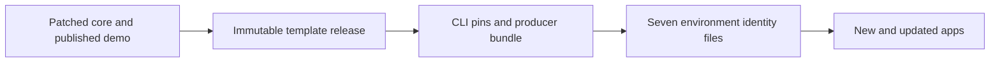
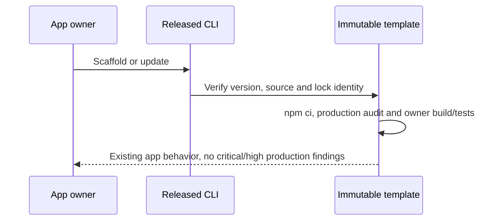

# Plan: Remove critical/high production dependency findings (#3653)

- **Engineer:** Codex, implementing the user's supplied plan
- **Primary repo:** eai-app-template; shared changes in enterpriseai-packages, eai-cli and Infra2025
- **Issue:** https://github.com/enterpriseaigroup/Issues2025/issues/3653
- **Status:** implementation authorized by explicit user approval-gate waiver, 2026-11-12

## 1. Why — business outcome

New and updated generated apps must have zero critical/high production audit findings, build successfully and retain existing behavior. Audit severity does not establish exploitability. Moving tooling alone is insufficient.

## 2. Customer journey

Keep the existing CLI scaffold/update journey, demo, workflow, registry/theme and Entra login/logout. Preserve server-side tokens, BFF routing and empty/prefixed base paths. No new user steps, public API or database migration.

## 3. Ecosystem scan

Owners: packages (core 3.1.2; published demo 1.0.107), template (core 1.0.129), CLI (template identity and producer bundle), Infra (seven environment/region sources). Coordinate #3639. Infra #1005 is merged; live propagation remains unverified.

## 4. Blast radius

Reach: core manifest/lock/packed exports/static registry; template manifest/lock/config/callers/owner tests/CI; CLI immutable template pins, producer bundle and guard tests; Infra's three template-identity keys across seven files. Preserve unrelated consumers, Gofer pins and existing #3638 CLI work. Never invent a released SHA or package receipt.

## 5. Multi-tenancy

No tenant contract changes: retain JWT/session tenant context, workspace/app authorization, OPA and storage isolation. Tokens remain server-side; no new routes or resource access.

## 6. Multi-region

Keep AU control-plane ownership and regional PublicAPI routing/residency unchanged. Infra must carry identical release identity in DEV AE, TEST AE/CC/GWC and PROD AE/CC/GWC. Source changes do not prove deployed identity.

## 7. Architecture

## 8. Flows

### Happy path

### Failure paths

Registry/network errors or critical/high findings fail CI with retained JSON. Identity/hash mismatches reject scaffold/update/deploy. Preserve auth expiry/logout and authorization failures; malformed workflow requests return 400 and oversized requests 413. Missing live evidence is incomplete, not passed.

## 9. UI/UX

N/A — dependency remediation only; preserve existing UI, accessibility, loading and error behavior.

## 10. Performance, scalability, responsiveness

No additional hot-path requests or abstractions. Keep current workflow request limits, image processing and standalone packaging. Build with dev dependencies available; tooling is not a production dependency.

## 11. Infra and config

Change only EAI_GENERATED_APP_TEMPLATE_RUNTIME_VERSION, EAI_GENERATED_APP_TEMPLATE_RUNTIME_COMMIT_SHA and ADMIN_EAI_GENERATED_APP_TEMPLATE_RUNTIME_COMMIT_SHA in all seven environment/region files, after a real immutable release exists. No secrets, resources or direct App Configuration writes.

## 12. Options and reasoning

### Option A — core 1.x backport

Smaller migration, but retains an older package line and duplicate maintenance.

### Option B — core 3.x security patch

Current package line and lasting CI protection; broader compatibility/regression testing.

### Decision

User selected B. Remove unused core Zod; admit Sharp 0.35.5. Pin patched core and demo 1.0.107. Use Next 15.5.29, next-auth 5.0.0-beta.32, Axios 1.21.1, Zod 4.6.7, Sharp 0.35.5 and PostCSS >=8.5.18. Resolve remaining production critical/high findings without forced audit fixes or suppressions.

## 13. Test and release evidence

This changes no cross-service contract. Validate clean Node 24 install, lock parity, one core, packed exports/static registry, production audit JSON, typecheck/build and owning tests. Exercise demo/registry/theme, workflow invalid/oversized requests, favicon/document images and Entra expiry/logout/BFF base paths. Verify released CLI scaffold and v1.0.20 update/hash guards with disposable relationship/file Object Types. Tests stay in owning repos, not Vanguard. Packages precede immutable template, then CLI/Infra; DEV/TEST validation precedes separately approved PROD. Keep issues open until deployment and all three PROD identities are evidenced. These checks are requirements, not passing results.

## 14. MVP negotiation (80:20)

### In MVP

All supplied dependency, minimal compatibility, CI, coordinated release and verification work.

### Deferred

Markdown/Notion/visual publication beyond this implementation record; unrelated package consumers and code. Release/deployment steps require real immutable artifacts and their existing operational gates.

### Cut

None from the supplied security target. No advisory exceptions, new APIs or database migrations.

### Decision log

- 2026-11-12: User requested implementation, then explicitly said "skip approval". This waives the dated Product/CEO plan-approval prerequisite for #3653 only; it does not assert either role approved, waive runtime evidence, authorize unrelated #3638 changes or authorize PROD promotion.
- Original unresolved questions: none. Package availability and compatibility must be verified, not assumed.

### Approvals

- Product: not recorded; prerequisite waived by the user for #3653.
- CEO: not recorded; prerequisite waived by the user for #3653.
